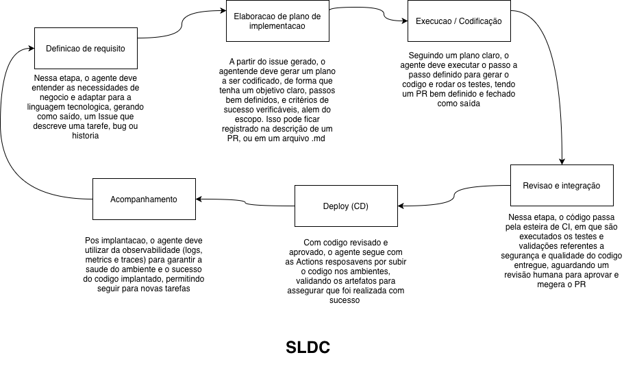

# Curso - Modulo 1: Fundamentos da IA agente no GitHub

Fonte: [Fundamentos da IA Agente no GitHub](https://learn.microsoft.com/pt-br/training/modules/foundations-agentic-ai/)

Cobertura da prova: introducao transversal, com enfase no **Dominio 1 - Preparar a arquitetura do agente e os processos do SDLC**.

O modulo tem 8 unidades e apresenta como agentes de codificacao de IA planejam, executam e melhoram o trabalho dentro dos workflows do GitHub.

## Resumo

### O que e IA agente

Um agente de IA trabalha para atingir um objetivo usando um modelo, instrucoes, contexto e ferramentas. Diferente de um assistente que normalmente responde ou sugere, um agente pode planejar etapas, tomar acoes, observar resultados e continuar o trabalho com algum grau de autonomia.

No desenvolvimento de software, essa autonomia precisa estar limitada por escopo, permissoes, revisao e evidencias.

### Agentes no SDLC

O agente pode participar de varias etapas do ciclo de vida:

- entender e decompor requisitos;
- propor um plano de implementacao;
- alterar codigo ou configuracao;
- executar testes e verificacoes;
- preparar uma pull request;
- analisar feedback e sugerir melhorias;
- apoiar operacao e manutencao.

A responsabilidade pelo resultado continua sendo humana e organizacional. O agente acelera o trabalho, mas nao substitui revisao, governanca ou decisao tecnica.

### Ciclo planejar -> agir -> avaliar

O ciclo central do modulo e:

1. **Planejar**: entender o objetivo, contexto, restricoes e criterios de sucesso.
2. **Agir**: usar ferramentas para pesquisar, editar, testar ou registrar o resultado.
3. **Avaliar**: verificar evidencias, qualidade, seguranca e aderencia ao objetivo.
4. **Repetir ou encerrar**: corrigir o plano quando necessario ou finalizar com um resultado revisavel.

Esse ciclo transforma uma conversa em um processo observavel. Cada etapa deve deixar sinais que permitam entender o que foi tentado e por que uma decisao foi tomada.

### GitHub como sistema de registro e plano de controle

O GitHub concentra os artefatos e controles que tornam o trabalho do agente rastreavel:

- issues e discussions registram objetivos e contexto;
- branches isolam mudancas;
- commits mostram alteracoes concretas;
- pull requests organizam revisao e feedback;
- Actions executam verificacoes automatizadas;
- regras, CODEOWNERS e protecao de branch definem limites;
- logs e artefatos ajudam a reconstruir a execucao.

O agente pode operar dentro desse fluxo, mas a plataforma precisa continuar sendo a fonte de verdade do que foi solicitado, alterado, testado e aprovado.

### Riscos e antipadroes

Alguns riscos importantes sao:

- aceitar uma alteracao sem verificar o resultado;
- dar ao agente mais permissoes do que a tarefa exige;
- confiar em contexto incompleto ou desatualizado;
- executar comandos destrutivos sem aprovacao;
- perder o historico de decisoes e evidencias;
- tratar uma saida plausivel como se fosse necessariamente correta.

Antipadroes comuns incluem o agente trabalhar sem criterio de sucesso, fazer mudancas fora do escopo, pular testes e operar sem um ponto claro de revisao humana.

### Modelo de colaborador

O modelo de colaborador ajuda a avaliar o trabalho gerado pelo agente como uma contribuicao que precisa ser revisada. A pessoa responsavel deve:

- fornecer contexto e objetivo claros;
- inspecionar o plano e as alteracoes;
- executar ou revisar verificacoes;
- confirmar seguranca e aderencia ao escopo;
- aprovar, pedir ajustes ou rejeitar o resultado.

A qualidade da colaboracao depende menos de aceitar rapidamente a resposta e mais de criar um ciclo curto de feedback verificavel.

## Fluxo do SDLC com IA agente

## Checklist de aprendizado

- [x] Consigo diferenciar agente de assistente.
- [x] Consigo explicar planejar, agir e avaliar.
- [x] Consigo descrever GitHub como sistema de registro e plano de controle.
- [x] Sei apontar pelo menos tres riscos de autonomia sem supervisao.
- [x] Sei explicar quais evidencias preciso revisar antes de aprovar trabalho gerado por agente.

## Perguntas de revisao

1. Em que ponto do SDLC um agente pode gerar mais valor no seu projeto?
2. Que ferramentas ele precisaria e quais deveriam ser somente leitura?
3. Qual evidencia provaria que uma alteracao esta pronta para revisao?
4. Que acao deve sempre exigir aprovacao humana?
5. Como voce reconstruiria o que o agente fez depois de uma falha?

## Respostas

1. O agente pode atuar em mais de um ponto do SDLC, seja para definir requisitos, criar um plano, executar mudancas,
realizar validacoes verificaveis ou revisar a entrega, mas isso depende da forma como configuramos o ambiente e organizamos permissoes e acessos para manter o ciclo seguro, iteravel e agil.

2. Ele deve ter acesso a criacao de branchs, a alteracao de arquivos fora de branchs protegidas, execucao de testes e execucao de revisoes, mas deve ser read-only para arquivos sensiveis, fluxo de deploy em producao e merges.

3. Boas evidencias seriam: suite de testes aprovada, plano especificado, review de qualidade e de secrets automatica aprovadas, e commits bem organizados.

4. Deploy em ambientes criticos, merge em branchs protegidas, delecao de repositorios, e alteracoes que impactem diretamente o codigo produtivo.

5. Tentaria entender o plano original, objetivo, passo a passo, verificaoes e escopo, e entao tentar localizar o que gerou a falha, para poder mitigar e propor uma nova solucao.

## Relacao com o GH-600

Este modulo fornece a base conceitual para os proximos temas: arquitetura do agente, escolha de ferramentas, memoria e estado, avaliacao, coordenacao multiagente e guardrails.
